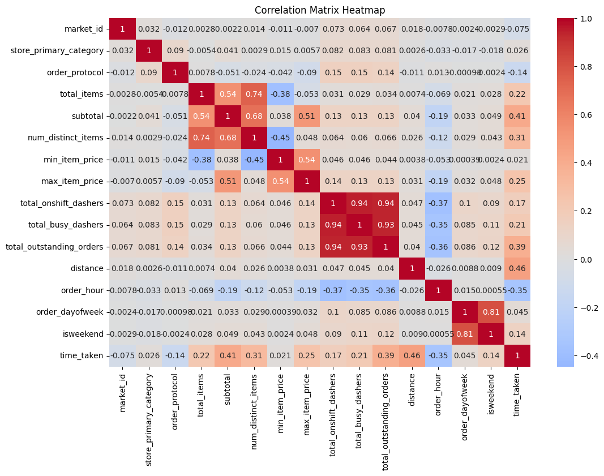
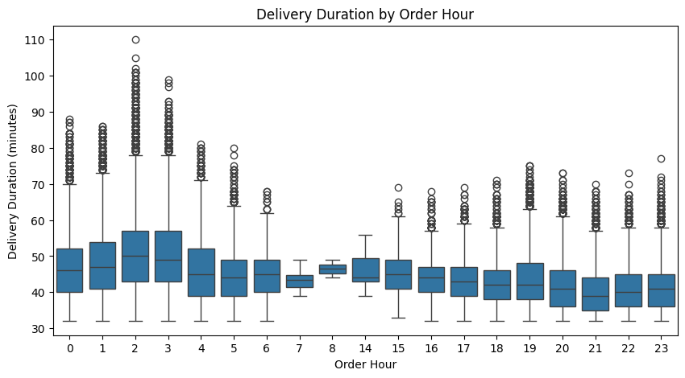
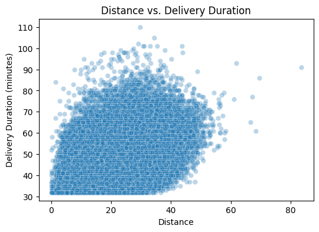
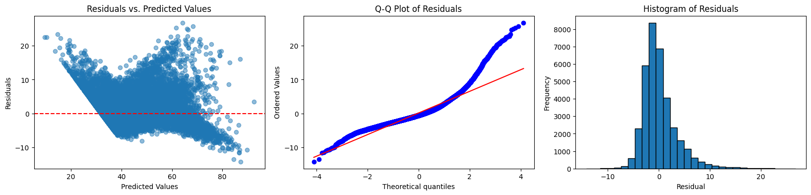

# Delivery Time Prediction with Linear Regression

A regression analysis of 175,777 food-delivery orders. It asks how well a linear model can predict **how long an order takes to arrive**, and which order and operating conditions drive that time. The work covers feature engineering from timestamps, exploratory analysis, outlier handling, recursive feature elimination (RFE), and residual diagnostics.

The full analysis is in [`notebooks/delivery_time_prediction.ipynb`](notebooks/delivery_time_prediction.ipynb). Supporting write-ups:

- [`docs/methodology.md`](docs/methodology.md): how the data was prepared, cleaned and modelled, and why
- [`docs/findings.md`](docs/findings.md): results and the limitations of the analysis

## Highlights

- **Test-set accuracy.** A linear regression on 8 features chosen by RFE reaches an MAE of 2.39 minutes, an RMSE of 3.39 minutes and an R² of 0.87 on 35,156 held-out orders.
- **Distance matters most.** It has the strongest correlation with delivery duration (0.46), followed by subtotal (0.41), outstanding orders (0.39) and order hour (−0.35).
- **Early-morning orders are slowest.** Orders placed at 2 and 3 am have a median duration of about 49 to 50 minutes, against about 39 to 41 minutes from 8 pm to 11 pm.
- **Capacity measures move together.** Delivery partners on shift, partners busy and outstanding orders correlate 0.93 to 0.94 with one another, so the model cannot separate their individual effects.
- **Long deliveries are under-predicted.** Residuals are right-skewed, reaching about +25 minutes while negative residuals stop near −14.

## Charts









## Approach

| Stage | What happens |
| --- | --- |
| 1. Prepare | Timestamps are parsed, delivery duration is derived in minutes, and order hour, day of week and a weekend flag are added. The data is split 80/20 (seed 42) before any exploration. |
| 2. Explore | Distributions, relationships with the target and a correlation heatmap, all on the training set. |
| 3. Clean | Three weakly correlated features are dropped, and outliers are removed from the training set with the 1.5 × IQR rule. |
| 4. Model | Numeric features are standardised, RFE ranks the 12 remaining features, and a linear regression is fitted on the top 8. |
| 5. Evaluate | MAE, RMSE and R² on the test set, and residual plots. |

## Repository layout

```
delivery-time-prediction/
├── notebooks/
│   └── delivery_time_prediction.ipynb   # the full analysis, run top to bottom
├── docs/
│   ├── methodology.md                   # preparation, cleaning and modelling decisions
│   ├── findings.md                      # results and limitations
│   └── images/                          # charts used in this README
├── data/
│   └── README.md                        # expected data file and columns
├── requirements.txt
└── README.md
```

## Running the notebook

1. Create an environment and install the dependencies:

   ```bash
   python -m venv .venv
   source .venv/bin/activate          # Windows: .venv\Scripts\activate
   pip install -r requirements.txt
   ```

2. Place the dataset at `data/porter_data_1.csv` (see [`data/README.md`](data/README.md)). The file was supplied with a course and is not stored in this repository.
3. Open `notebooks/delivery_time_prediction.ipynb` in Jupyter and choose *Restart & Run All*. The sweep over feature counts fits twelve linear models, so the run is short.

The notebook keeps the outputs from the original run, so the results can be read without the data.

## Scope and limitations

The analysis is descriptive and uses a single model family. These limits matter when reading the results (details in [`docs/findings.md`](docs/findings.md)):

- **The feature count was chosen on test-set error,** so the reported metrics are slightly optimistic.
- **One random split, no cross-validation.**
- **Identifiers enter the model as numbers.** `market_id` and `order_protocol` are not one-hot encoded.
- **Collinear capacity features** make their individual effects impossible to separate.
- **Outliers were removed from the training set only,** so the model is weakest on long deliveries.
- **The time zone of the timestamps and the units of `distance` are not stated** in the source.

## About this project

This started as a case study in a data-science course. The course brief, marking scheme and submitted report are not part of this repository; the analysis code and write-up here are mine.

Built with Python, pandas, NumPy, matplotlib, seaborn, SciPy and scikit-learn.
